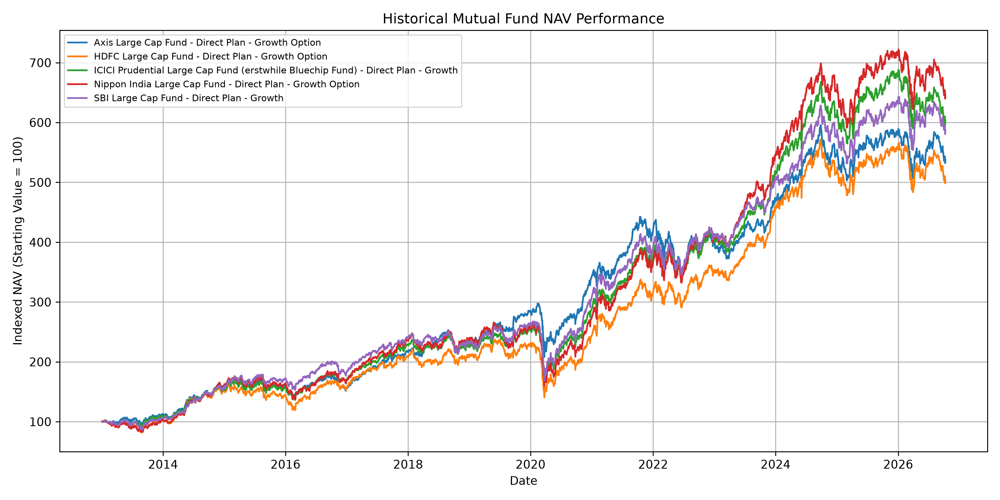

# Mutual Fund Analytics Report

## 1. Project Overview

The objective of this project is to analyze mutual fund datasets, retrieve historical Net Asset Value (NAV) data, clean the data, calculate performance metrics, and visualize the performance of selected mutual funds.

## 2. Tools and Technologies

* Python
* Pandas
* NumPy
* Matplotlib
* CSV datasets
* MFAPI mutual fund API
* Visual Studio Code

## 3. Dataset Overview

The initial data ingestion process examined 10 CSV datasets containing a total of 87,533 rows and 81 columns.

The datasets include investor transactions, portfolio holdings, benchmark indices, fund master information, NAV history, assets under management, SIP inflows, category inflows, folio counts, and scheme performance.

## 4. Fund Master Analysis

The Fund Master dataset contains 40 mutual fund schemes from 10 fund houses.

Key findings:

* Total schemes: 40
* Fund houses: 10
* Equity schemes: 34
* Debt schemes: 6
* Unique AMFI codes: 40
* Duplicate AMFI codes: 0

The analysis also examined fund categories, subcategories, and risk classifications.

## 5. NAV Data Collection

Historical NAV data was collected for five large-cap mutual fund schemes:

1. Nippon India Large Cap Fund
2. HDFC Large Cap Fund
3. SBI Large Cap Fund
4. Axis Large Cap Fund
5. ICICI Prudential Large Cap Fund

The collected data contains 16,964 records before cleaning, covering dates from January 2013 through October 2026.

## 6. Data Cleaning

The NAV data was checked for missing values, duplicate records, duplicate scheme-date combinations, and non-positive NAV values.

The cleaned dataset contains 16,963 records.

No missing values or non-positive NAV values remained after cleaning. Duplicate scheme-date combinations were also removed.

## 7. NAV Performance Analysis

The performance analysis calculated:

* First and latest NAV
* Minimum and maximum NAV
* Average NAV
* Total NAV return over the available period
* Average daily return
* Daily return volatility
* Number of NAV records

### Total NAV Return Results

| Mutual Fund                     | Total NAV Return |
| ------------------------------- | ---------------: |
| Nippon India Large Cap Fund     |          546.91% |
| ICICI Prudential Large Cap Fund |          503.05% |
| SBI Large Cap Fund              |          486.57% |
| Axis Large Cap Fund             |          437.95% |
| HDFC Large Cap Fund             |          403.60% |

These figures represent the change between the first and latest NAV in the available dataset. They are not annualized returns.

## 8. Data Visualization

A line chart was created to compare the historical NAV performance of the five schemes.

Each scheme's starting NAV was converted to an index value of 100. This normalization allows the relative growth of the schemes to be compared despite differences in their starting NAV values.

Chart file: `Reports/nav_performance_chart.png`

## 9. Key Findings

* Five mutual fund schemes were selected for historical NAV analysis.
* Nippon India Large Cap Fund showed the highest total NAV increase in the collected period.
* Daily return volatility differed among the selected schemes.
* Data cleaning and validation helped prepare the data for analysis.
* Visualizing normalized NAV values made relative performance easier to compare.

These findings describe historical data and do not guarantee future performance or establish which fund is best for investment.

## 10. Conclusion

This project demonstrates a basic mutual fund analytics workflow, including data ingestion, data validation, API-based NAV collection, data cleaning, performance calculations, and visualization.

The resulting datasets, summary tables, and graph provide a foundation for further analysis, such as risk-adjusted returns, benchmark comparisons, and interactive dashboards.
